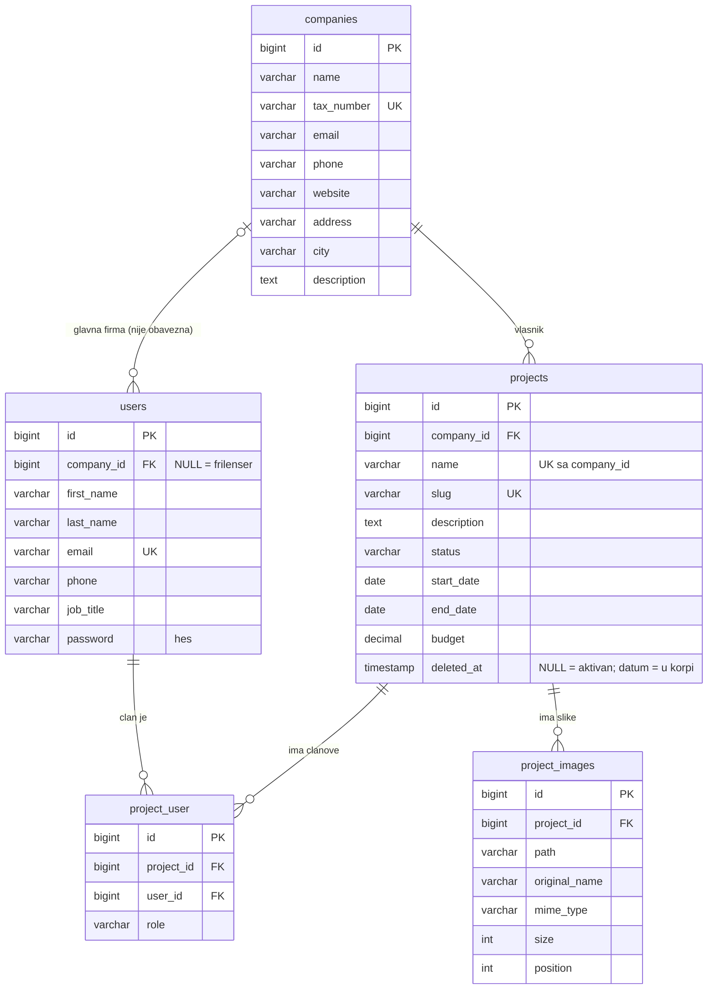

# Baza podataka

MySQL baza `company_projects`, 5 tabela aplikacije + Laravelove sistemske tabele
(`sessions`, `cache`, `jobs`, `migrations`...) i Sanctum tabela `personal_access_tokens`
(tokeni za prijavu: u bazi se cuva samo hes tokena, korisnik, vreme poslednje upotrebe) i `password_reset_tokens`
(zaboravljena lozinka: email, hes jednokratnog tokena iz linka i vreme pravljenja; red se brise kada se link iskoristi). Sve tabele prave migracije u
`backend/database/migrations/`, a test podatke seederi u `backend/database/seeders/`.

## Dijagram



Sve tabele imaju i `created_at` / `updated_at` (Laravel ih sam popunjava). U `project_user`
`created_at` je ujedno datum kada je korisnik dodat na projekat.

## Tabele i kolone

### `companies` — kompanije

| Kolona | Tip | Obavezno | Zasto postoji |
|---|---|---|---|
| `id` | bigint | da | Jedinstveni broj reda. |
| `name` | varchar(255) | da | Naziv firme. |
| `tax_number` | varchar(20), **unique** | da | PIB. Dve firme mogu imati isto ime, ali nikad isti PIB, pa je to pravi identitet firme. Tekst, a ne broj, jer PIB moze poceti nulom; validacija trazi tacno 9 cifara, a kolona ima mesta i za strane poreske brojeve. |
| `email` | varchar(255) | ne | Kontakt adresa firme. |
| `phone` | varchar(30) | ne | Tekst, a ne broj: `+381`, vodece nule i razmaci. |
| `website` | varchar(255) | ne | Sajt; validacija prihvata samo ispravan URL. |
| `address` | varchar(255) | ne | Ulica i broj. |
| `city` | varchar(100) | ne | Odvojen od adrese, da bi moglo da se filtrira/grupise po gradu. |
| `description` | text | ne | Delatnost firme; `text` jer moze biti duze od 255 znakova. |

### `users` — korisnici

| Kolona | Tip | Obavezno | Zasto postoji |
|---|---|---|---|
| `id` | bigint | da | |
| `company_id` | FK -> `companies.id` | **ne** | Glavna firma korisnika. `NULL` = frilenser ili korisnik cija je firma obrisana (vidi pitanje 2). |
| `first_name`, `last_name` | varchar(100) | da | Ime i prezime odvojeno (umesto Laravelovog `name`): sortiranje po prezimenu, obracanje po imenu. API vraca i spojeno `full_name`. |
| `email` | varchar(255), **unique** | da | Jedinstven, jer bi sluzio za prijavu. |
| `phone` | varchar(30) | ne | |
| `job_title` | varchar(100) | ne | Pozicija **u firmi** (npr. "Backend developer"). Nije isto sto i uloga na projektu: neko je "Backend developer" u firmi, a "manager" na jednom projektu. |
| `password` | varchar(255) | da | Cuva se samo **hes** (`'password' => 'hashed'` u modelu); API je nikad ne vraca. |
| `email_verified_at`, `remember_token` | | ne | Laravelove kolone za potvrdu emaila i "zapamti me". |

### `projects` — projekti

| Kolona | Tip | Obavezno | Zasto postoji |
|---|---|---|---|
| `id` | bigint | da | |
| `company_id` | FK -> `companies.id` | da | Firma kojoj projekat pripada; projekat bez firme nema smisla. |
| `name` | varchar(255) | da | Naziv. **Unique zajedno sa `company_id`**: ista firma ne moze imati dva projekta istog imena, razlicite firme mogu. |
| `slug` | varchar(255), **unique** | da | Deo javne adrese `/showcase/{slug}` (npr. `crm-sistem-iris`). Pravi se sam iz naziva pri kreiranju (`Project::creating`); ako je zauzet dobija `-2`, `-3`... **Ne menja se** kad se naziv promeni, da podeljeni linkovi ne bi prestali da rade. |
| `description` | text | ne | Opis projekta. |
| `status` | varchar(20), index | da | `planned` / `active` / `on_hold` / `completed` (PHP enum `ProjectStatus`); podrazumevano `planned`. Index ubrzava filtriranje i brojanje po statusu (dashboard). |
| `start_date`, `end_date` | date | ne | Pocetak i rok. `date`, a ne `datetime`: vreme u danu nije potrebno. Validacija: rok ne sme biti pre pocetka. |
| `budget` | decimal(12,2) | ne | **`decimal`, ne `float`**: `float` gresi na decimalama (0.1 + 0.2 != 0.3), a kod novca to ne sme da se desi. Najvise 2 decimale. |
| `deleted_at` | timestamp | ne | **Soft delete ("korpa")**: `NULL` = aktivan projekat, datum = projekat je u korpi. Laravel (`SoftDeletes`) projekte iz korpe sam izostavlja iz svih upita; mogu da se vrate ili trajno obrisu. Ime i slug projekta iz korpe ostaju "zauzeti", da vracanje nikad ne napravi duplikat. |

### `project_user` — clanovi projekta (pivot tabela)

| Kolona | Tip | Obavezno | Zasto postoji |
|---|---|---|---|
| `id` | bigint | da | |
| `project_id` | FK -> `projects.id` | da | Koji projekat. |
| `user_id` | FK -> `users.id`, index | da | Koji korisnik. |
| `role` | varchar(30) | da | Uloga na **tom** projektu: `manager` / `developer` / `designer` / `tester` (PHP enum `ProjectRole`). |

Par `project_id + user_id` je **unique**: isti korisnik je na istom projektu najvise jednom.
Korisnik moze biti clan projekata **drugih** firmi; aplikacija ga tada oznacava (zuto, "Druga firma" / "Frilenser")
po pravilu `member.company_id != project.company_id`.

### `project_images` — slike projekta

| Kolona | Tip | Obavezno | Zasto postoji |
|---|---|---|---|
| `id` | bigint | da | |
| `project_id` | FK -> `projects.id`, index | da | Projekat kome slika pripada. |
| `path` | varchar(255) | da | Putanja fajla na disku, npr. `projects/5/a8f3k....png` (disk `public` = `storage/app/public`). **Sama slika nije u bazi**, samo putanja. |
| `original_name` | varchar(255) | da | Ime fajla kako ga je korisnik poslao, za prikaz. Na disku je nasumicno ime, da se dva `slika.jpg` ne bi pregazila. |
| `mime_type` | varchar(100) | da | Tip fajla koji je odredio server iz sadrzaja (npr. `image/png`), ne iz ekstenzije. |
| `size` | int unsigned | da | Velicina u bajtovima, za prikaz ("1,2 MB"). |
| `position` | int unsigned, index (`project_id`, `position`) | da | Mesto slike u galeriji (1, 2, 3...), korisnik ga menja prevlacenjem. Nova slika dobija sledeci broj (na kraj). Isti redosled vazi u aplikaciji, na javnoj stranici i u API-ju. |

## Odgovori na pitanja iz zadatka

### 1. Koliko tabela treba za ove veze i zasto?

**Pet:** tri entiteta (`companies`, `users`, `projects`) + dve tabele za veze.

| Veza | Tip | Kako je resena |
|---|---|---|
| kompanija -> korisnici | jedan prema vise | kolona `users.company_id` (posebna tabela ne treba) |
| kompanija -> projekti | jedan prema vise | kolona `projects.company_id` |
| korisnik <-> projekat | **vise prema vise** | tabela `project_user`, jer jedna kolona ne moze da cuva vise vrednosti. Uloga (`role`) je u njoj, jer ne pripada ni korisniku ni projektu nego **njihovoj vezi**. |
| projekat -> slike | jedan prema vise | tabela `project_images`, jer svaka slika ima svoje podatke (putanja, ime, tip, velicina) |

### 2. Sta se desava sa projektima i korisnicima kada se obrise kompanija?

- **Projekti se brisu trajno** (i oni u korpi), jer projekat bez firme nema smisla. Sa njima se brisu i clanstva (`project_user`) i slike, **i fajlovi slika sa diska**.
- **Korisnici ostaju**, samo im `company_id` postaje `NULL`. Korisnik je osoba: moze biti clan projekata drugih firmi i moze preci u drugu firmu; brisanjem bismo izgubili i njegova clanstva na tudjim projektima.

U kodu:
- strani kljuc `users.company_id` ima `ON DELETE SET NULL`, a `projects.company_id` `ON DELETE CASCADE`;
- ali projekte ne prepustamo samo bazi: `Company::booted()` -> `deleting` brise svaki projekat (i iz korpe: `withTrashed()`)
  **trajno, preko Eloquent-a** (`forceDelete()`), jedan po jedan, da bi se za svaki pokrenuo `Project::forceDeleting`
  i obrisale slike sa diska (vidi pitanje 3);
- API brise kompaniju u transakciji (`DB::transaction`), pa se baza vraca ako nesto pukne usred brisanja.

### 3. Sta se desava sa slikama na disku kada se obrise projekat?

Brisanje projekta ima dva koraka (soft delete):

| Akcija | Slike na disku | Redovi u bazi |
|---|---|---|
| **U korpu** (`DELETE /api/projects/{id}`) | **ostaju** | projekat dobija `deleted_at`; slike i clanstva ostaju, pa projekat moze da se vrati kakav je bio |
| **Obrisi trajno** iz korpe (`DELETE /api/projects/{id}/force`) | **brisu se** | projekat, slike i clanstva se brisu |

Baza **ne zna da fajlovi postoje**. `ON DELETE CASCADE` bi obrisao redove iz `project_images`,
ali bi fajlovi ostali na disku zauvek ("sirocici").

Zato brisanje radi nas kod, preko model evenata:

```
Company::delete()
  -> Company "deleting":             trajno obrisi svaki projekat (i iz korpe) preko Eloquent-a
       -> Project "forceDeleting":   obrisi svaku sliku preko Eloquent-a
            -> ProjectImage "deleted": Storage::disk('public')->delete($path)   <- fajl nestaje sa diska

Project::forceDelete()  (dugme "Obrisi trajno" u korpi)  -> isti lanac od "forceDeleting"
Project::delete()       (obicno brisanje = korpa)         -> slike se NE diraju
```

- Fajl se brise **posle** uspesnog brisanja reda (`deleted`), pa ako brisanje iz baze pukne, slika ostaje i u bazi i na disku.
- Pri uploadu je obrnuto: ako upis u bazu pukne posle snimanja fajla, kontroler brise vec snimljene fajlove.
- **Zamka:** eventi se pokrecu samo kada se brise model po model (`$project->delete()`).
  Masovno brisanje (`Project::where(...)->delete()`) salje jedan SQL upit i eventi se **ne** pokrecu, pa bi fajlovi ostali.
  Zato aplikacija nigde ne brise projekte ni slike masovno.

Ovo proverava i test `backend/tests/Feature/DeletingRemovesImageFilesTest.php`
(brisanje slike, trajno brisanje projekta i brisanje kompanije -> fajl vise ne postoji na disku; projekat u korpi
zadrzava fajlove; korisnici ostaju bez firme) i `SoftDeleteProjectsTest.php` (korpa, vracanje, trajno brisanje).

## Kako se baza pravi i puni

```powershell
cd backend
php artisan migrate --seed          # tabele + test podaci
php artisan migrate:fresh --seed    # sve iz pocetka (BRISE sve podatke; samo lokalno)
```

Seeder pravi: 5 kompanija, 30 zaposlenih (6 po firmi) + 2 frilensera, 15 projekata (3 po firmi)
sa realnim statusima i datumima, i oko 85 clanstava: na svakom projektu menadzer i tim iz firme
+ 1-2 clana **iz drugih firmi ili frilensera**. Imena, gradovi i adrese su na srpskom (`APP_FAKER_LOCALE=sr_Latn_RS`).
Na kraju jedan nasumicni projekat ide u korpu, da korpa u aplikaciji ne bude prazna (14 aktivnih + 1 u korpi),
i pravi se nalog za prijavu `admin@example.com` / `password` (`AdminUserSeeder`; svi korisnici iz seedera imaju lozinku `password`).
